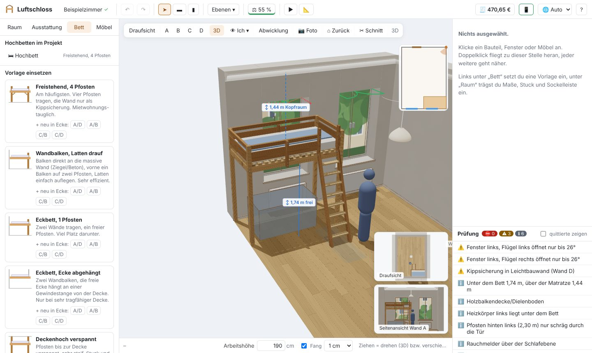
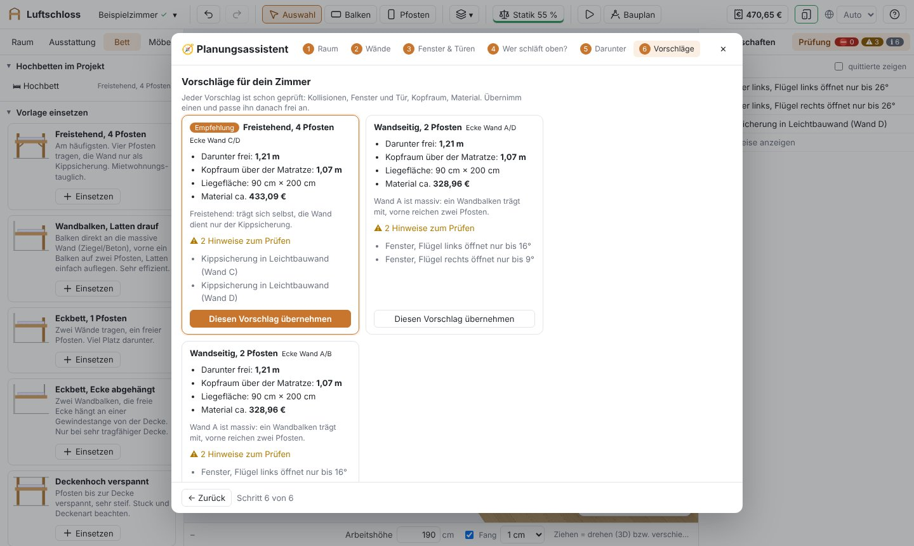
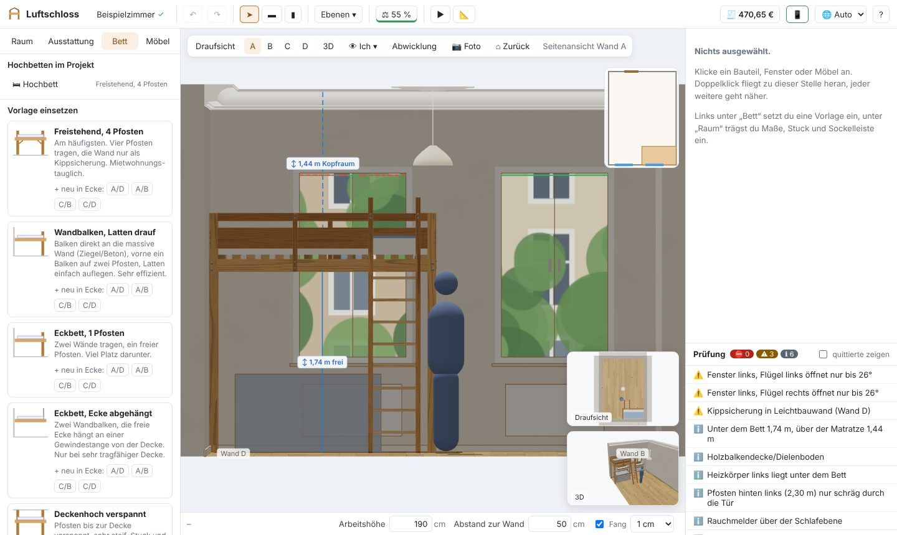
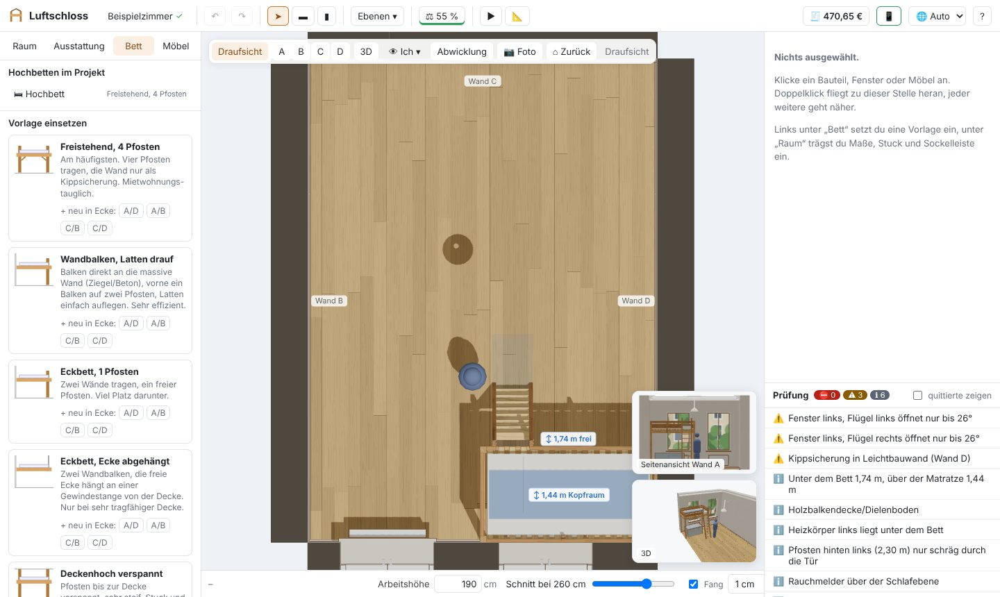
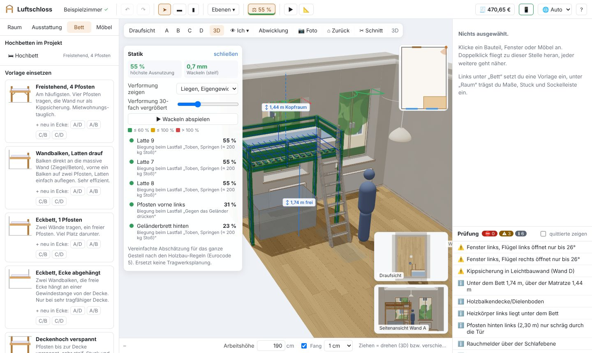
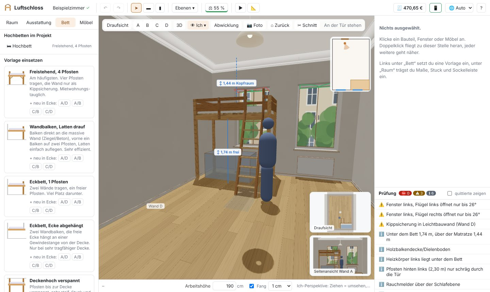
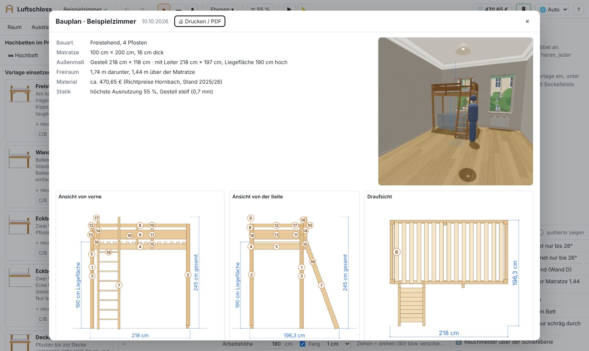
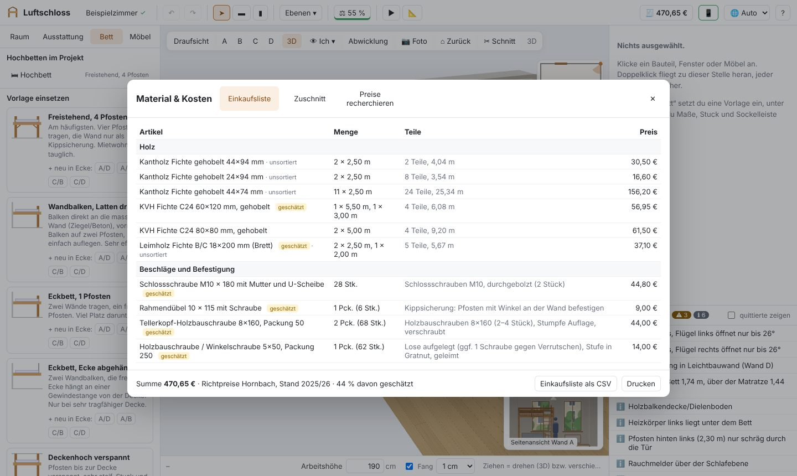
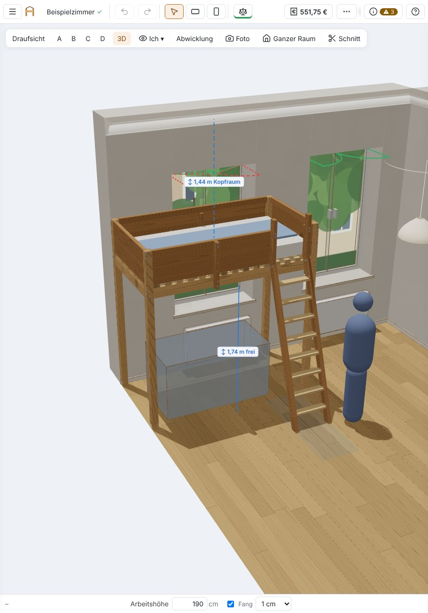

**Deutsch** · [English](README.md)

# Luftschloss 🏰 – plane dein Hochbett im echten Zimmer

**Du willst ein Hochbett selbst bauen?** Luftschloss zeigt dir vorher in 3D, ob es passt: ob die Fenster noch aufgehen, ob man darunter stehen kann, wo der Stuck im Weg ist. Am Ende bekommst du eine Einkaufsliste in echten Baumarkt-Längen und einen Bauplan zum Ausdrucken.

Alles läuft im Browser, kostenlos und ohne Anmeldung. Deine Daten bleiben auf deinem Gerät.

<p align="center">
  
</p>

## Sofort ausprobieren

**👉 [Luftschloss im Browser öffnen](https://jo-tud.github.io/Luftschloss/)** – keine Installation nötig.

- Läuft in jedem aktuellen Browser auf Laptop, PC und Tablet (Chrome, Edge, Firefox, Safari).
- **Als App aufs Tablet oder Handy:** Link öffnen und im Browsermenü „Zum Home-Bildschirm“ (iPad/iPhone) bzw. „App installieren“ (Android, Chrome) wählen. Danach startet Luftschloss wie eine App und funktioniert auch offline.
- Beim ersten Start ist ein **Beispielzimmer** geladen: einfach herumklicken, das Bett auswählen und verschieben, Maße ändern. Der Knopf **🧭 Eigenes Zimmer planen** in der Leiste über der Ansicht startet den Planungsassistenten.
- **Neu dabei? Der Planungsassistent 🧭 hilft.** Ein paar kurze Schritte – Raumgröße und Decke, Wände, Fenster/Türen/Heizkörper, wer oben schläft, was darunter soll und ob in die Wand geschraubt werden darf – und du bekommst bis zu drei geprüfte Vorschläge. Einen übernehmen und weiter anpassen.

<p align="center">
  
</p>


## Was du damit machen kannst

| | |
|---|---|
|  |  |
| **Dein Zimmer, wie es wirklich ist:** Fenster mit Flügeln und Fensterbank, Heizkörper, Tür, Steckdosen, Stuck, Deckenrosette mit Lampe, Sockelleisten, Dachschrägen, Kaminvorsprünge und L-förmige Räume. | **Bett einsetzen und anpassen:** Vorlage wählen, in die Ecke schieben, Abstand zu jeder Wand eintippen. Alles bleibt jederzeit änderbar. |
|  |  |
| **Hält das?** Eine vereinfachte Statik rechnet das ganze Gestell durch: Ausnutzung jedes Balkens, Wackeln, Belastung beim Toben. | **Wie fühlt es sich an?** In der Ich-Perspektive stehst du an der Tür, sitzt unter dem Bett oder liegst auf der Matratze. |
|  |  |
| **Bauplan zum Ausdrucken:** Ansichten mit Maßen, Teileliste mit Nummern, Skizzen der Verbindungen, Montageschritte. | **Einkaufsliste:** Holz in Hornbach-Handelslängen, Zuschnittplan, Schrauben und Winkel, Richtpreise, Export als CSV. |

**Außerdem:**

- **Viele Bauarten:** freistehend, an der Wand, Eckbett, deckenhoch verspannt, Wand zu Wand, Halbhoch, Etagenbett, Galerie, Netz-Hochebene – und zwei Kinder nebeneinander auf zwei Matratzen.
- **Echte Holzverbindungen:** Überblattung, Zapfen mit Holznagel, Schwalbenschwanzblatt, Gratnut, Einlassung, Rundstab in Bohrung, Auflagerleiste, Kopfbänder auf Gehrung und eingelassen. Ein Klick auf eine Verbindung zeigt sie als 3D-Explosion mit Erklärung, wie sie wirkt, und den Arbeitsschritten; im Bauplan erscheint sie als isometrische Skizze.
- **Prüfliste mit Erklärungen:** Fensterflügel, die anstoßen, zu wenig Kopfraum, Lücken im Geländer, falsche Dübel in Leichtbauwänden … Alles sind Empfehlungen, die du bewusst „zur Kenntnis nehmen“ kannst.
- **Dein Hochbett im Foto deines Zimmers:** Foto laden, ein paar Ecken antippen – das geplante Bett erscheint perspektivisch richtig im Foto.
- **Aufbau-Animation:** Die Teile fliegen in der Reihenfolge ein, in der du sie später zusammenbaust.
- **Echt aussehendes Holz:** Maserung, Jahresringe an den Stirnseiten, sichtbare Schlossschrauben, Winkel und Balkenschuhe, Stuck, Dielenboden – durchs Fenster der Blick nach draußen und auf Wunsch Sonnenlicht zur gewählten Uhrzeit. Doppelklick fliegt zu jeder Stelle heran.
- **Deine Arbeitsfläche:** Seitenleisten am Rand ziehen und in der Größe anpassen, den Raum mit der Schnittbox ✂ aufschneiden, für ältere Tablets eine einfachere Darstellungsqualität wählen.
- **Deutsch und Englisch:** Luftschloss spricht beide Sprachen – automatisch passend zur Browsersprache, umschaltbar über 🌐 in der Werkzeugleiste.
- **Aktuelle Preise:** Recherche-Prompt für einen KI-Chat kopieren oder mit eigenem Claude-API-Schlüssel direkt recherchieren lassen.

## Auf dem Tablet



Mit Finger oder Stift: antippen wählt aus, ein ausgewähltes Teil ziehst du mit einem Finger, ein Finger auf leerer Fläche dreht, mit zwei Fingern zoomst, verschiebst und drehst du. ☰ öffnet Raum und Vorlagen, ⓘ die Eigenschaften und die Prüfliste.

**Laptop und Tablet gleichzeitig am selben Projekt**, z. B. in der Werkstatt: Luftschloss auf dem Laptop mit `npm run lan` starten (siehe unten), oben in der Werkzeugleiste auf das Tablet-Symbol klicken und den QR-Code scannen. Änderungen gleichen sich alle paar Sekunden ab. Ohne gemeinsames WLAN klappt das mit [Tailscale](https://tailscale.com).

<br clear="right">

## Auf dem eigenen Rechner starten

Du brauchst nur [Node.js](https://nodejs.org) (Version 22 oder neuer). Dann:

```sh
git clone https://github.com/jo-tud/Luftschloss.git
cd Luftschloss
npm install
npm run dev
```

Luftschloss öffnet sich unter <http://localhost:5173>.

| Befehl | Wofür |
|---|---|
| `npm run dev` | Entwickeln mit automatischem Neuladen |
| `npm run lan` | Bauen und im WLAN freigeben – fürs Tablet, mit Projekt-Abgleich (gespeichert im Ordner `projekte/`) |
| `npm test` | Tests (Vitest) |
| `npm run build` | Typprüfung und Produktions-Build nach `dist/` |

Die Freigabe im WLAN hat keine Anmeldung – nur im eigenen Netz bzw. Tailnet nutzen.

## Bedienung in Kürze

| Aktion | Maus / Tastatur |
|---|---|
| Ansicht wechseln | Leiste oben im Bild oder `1` Draufsicht, `2` Seitenansicht (nochmal = nächste Wand), `3` 3D, `4` Ich-Perspektive, `5` Abwicklung, `6` Foto, `0` Ansicht zurücksetzen |
| Drehen, verschieben, zoomen | Ziehen auf leerer Fläche (in 3D drehen, in 2D verschieben), rechte Maustaste oder `Alt`+Ziehen dreht, mittlere Maustaste verschiebt, Mausrad zoomt, Doppelklick fliegt näher heran. Lieber wie im CAD? Mausbelegung „CAD“ unter Raum → Einstellungen |
| Ich-Perspektive | Ziehen = umsehen, `W` `A` `S` `D` oder Pfeiltasten = gehen, `Q`/`E` runter/hoch, Mausrad = Blickwinkel |
| Auswählen / Querschnitt drehen / Fokus | `V` / `R` / `F` |
| Bett verschieben | anklicken, dann ziehen (hält an Wänden an) – oder genau unter „Lage im Raum“ |
| Zeichnen | `B` Balken, `P` Pfosten, `Esc` abbrechen |
| Rückgängig / Wiederholen | `Strg+Z` / `Strg+Y` |
| Löschen | `Entf` oder 🗑 oben in den Eigenschaften |
| Hilfe | `?` |

## Mitmachen

Luftschloss ist mit React, TypeScript und three.js gebaut. Ideen, Fehlerberichte und Pull Requests sind willkommen.

```
src/model      Datenmodell, Holz-Katalog, Geometrie, Raum, Hochbett-Generator
src/analysis   Prüfungen, Statik, Stückliste, Zuschnitt, Foto-Abgleich, Preis-Agent
src/state      Zustand, Rückgängig, Speichern
src/views      3D-Szene, Kamera, Ansichten
src/ui         Oberfläche
src/i18n       Übersetzungen (Englisch / Deutsch)
tests          Vitest-Tests
docs           Recherchen, UX-Review, Screenshots
```

Mehr Hintergrund: [Spezifikation und Ausbaustufen](SPEZIFIKATION.md), [Recherchen](docs/recherche/) zu Holzsortiment, Statik, Verbindungen und Heimwerker-Praxis, [UX-Review](docs/ux-review/bericht-2026-10-10.md).

## Wichtig

Luftschloss ersetzt keine Tragwerksplanung. Die Prüfungen sind Empfehlungen auf Basis von Normen-Richtwerten (z. B. DIN EN 747), Herstellerangaben und Heimwerker-Erfahrung. Vor dem Zuschnitt alle Maße am Bau nachmessen.

## Lizenz

[MIT](LICENSE) – frei nutzbar, auch zum Verändern und Weitergeben.
