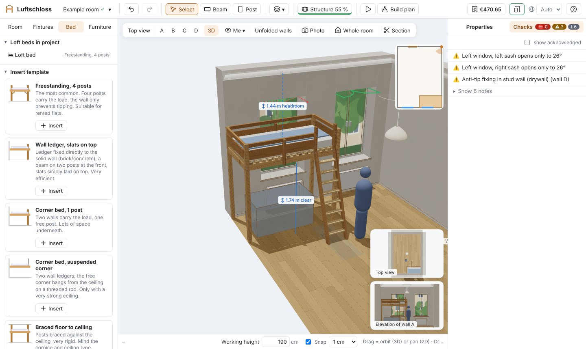
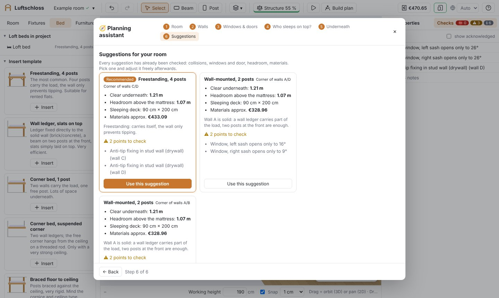
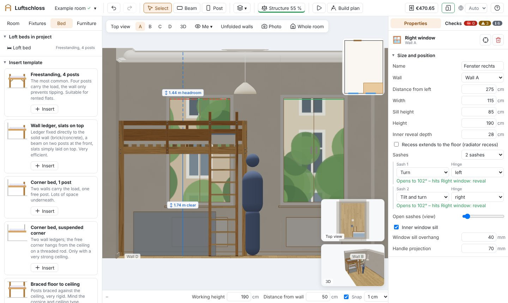
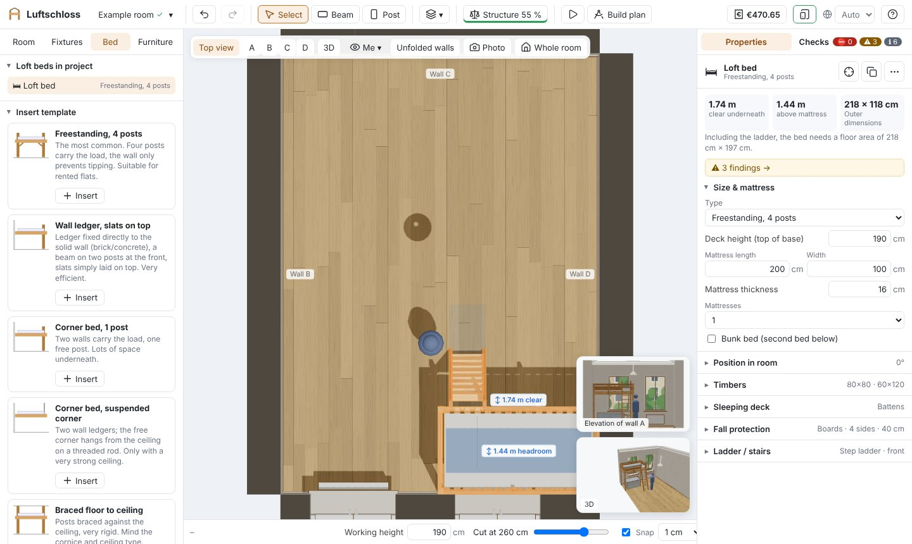
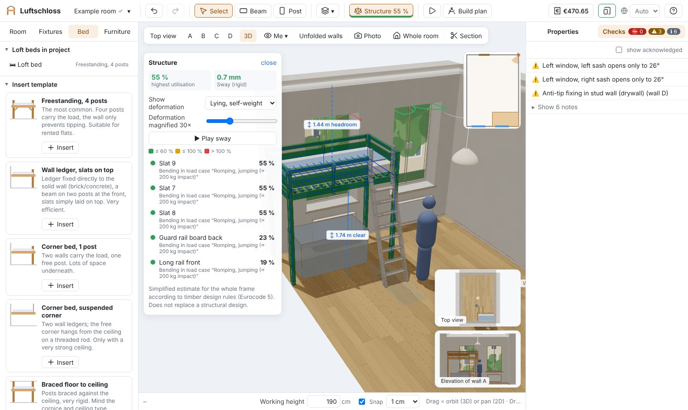
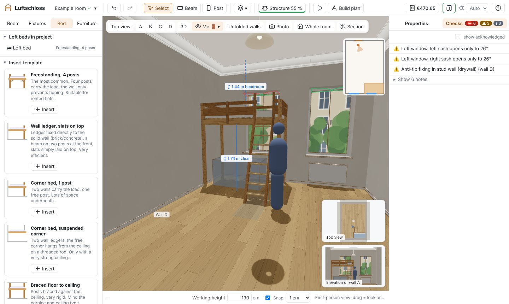
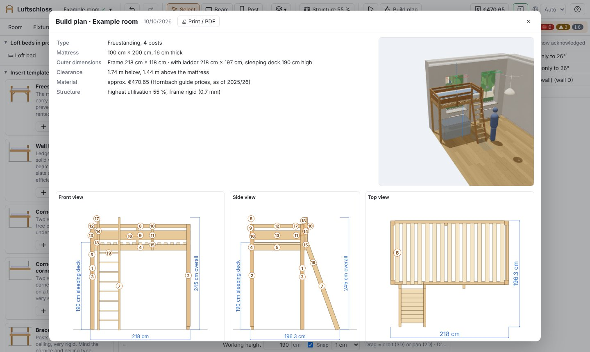
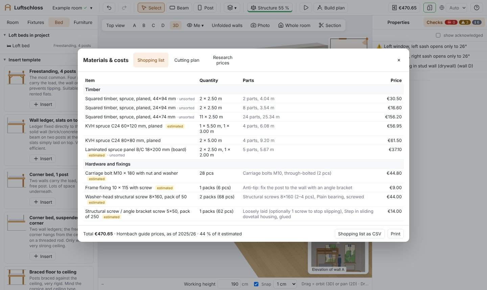
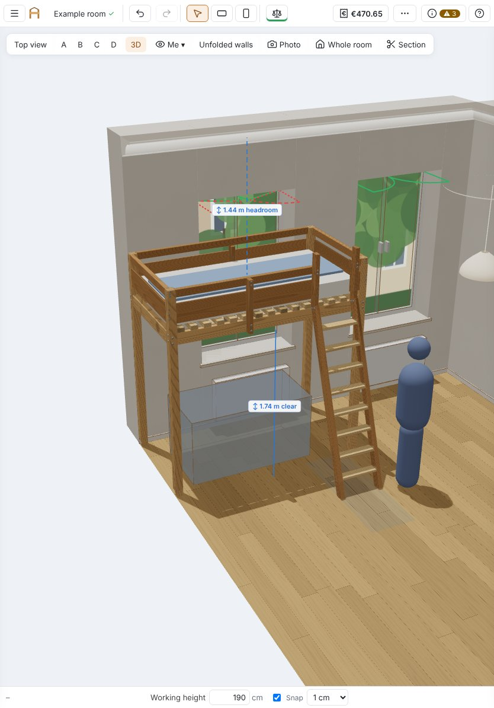

[Deutsch](README.de.md) · **English**

# Luftschloss 🏰 – plan your loft bed in your real room

**Want to build a loft bed yourself?** Luftschloss shows you in 3D whether it fits before you buy a single board: will the windows still open, can you stand underneath, is the ceiling moulding in the way? When you are done, you get a shopping list in real DIY-store timber lengths and a build plan to print out.

Everything runs in your browser – free, no sign-up. Your data stays on your device.

<p align="center">
  
</p>

## Try it now

**👉 [Open Luftschloss in your browser](https://jo-tud.github.io/Luftschloss/)** – nothing to install.

- Works in any current browser on laptop, desktop and tablet (Chrome, Edge, Firefox, Safari).
- **Install it as an app on your tablet or phone:** open the link and choose "Add to Home Screen" (iPad/iPhone) or "Install app" (Android, Chrome) in the browser menu. Luftschloss then starts like a regular app and also works offline.
- On first launch an **example room** is loaded: just click around, select the bed, drag it, change dimensions. The button **🧭 Plan your own room** in the strip above the view starts the planning assistant.
- **New to this? Use the planning assistant 🧭.** A few short steps – room size and ceiling, walls, windows/doors/radiators, who sleeps on top, what goes underneath and whether you may screw into the walls – up to three checked suggestions. Pick one and keep adjusting.

<p align="center">
  
</p>

- **English or German:** Luftschloss picks the language of your browser automatically (German browsers get German, everyone else English). Switch any time with 🌐 in the toolbar.

## What you can do with it

| | |
|---|---|
|  |  |
| **Your room as it really is:** windows with sashes and sill, radiator, door, sockets, cornice moulding, ceiling rose with lamp, skirting boards. | **Drop in a bed and adjust it:** pick a template, push it into a corner, type in the distance to each wall. Everything stays editable at all times. |
|  |  |
| **Will it hold?** A simplified structural analysis checks the whole frame: utilisation of every beam, wobble, loads when kids jump around. | **How does it feel?** In first-person view you stand at the door, sit under the bed or lie on the mattress. |
|  |  |
| **Printable build plan:** dimensioned views, numbered parts list, joint sketches, assembly steps. | **Shopping list:** timber in stock lengths, cutting plan, screws and brackets, estimated prices, CSV export. |

**And there's more:**

- **Lots of designs:** freestanding, against the wall, corner bed, floor-to-ceiling tension-mounted, wall to wall, mid-height, bunk bed, gallery, net platform – and two kids side by side on two mattresses.
- **Real carpentry joints:** half-lap, mortise and tenon with peg, dovetail lap, sliding dovetail, housing, round bar in a hole, ledger strip, mitred and housed knee braces. Click a joint to see it as an exploded 3D detail with an explanation of how it works and the steps to make it; the build plan shows it as an isometric sketch.
- **Checklist with explanations:** window sashes that bump into the frame, too little headroom, gaps in the guard rail, the wrong anchors in stud walls … These are all recommendations you can consciously acknowledge and dismiss.
- **Your loft bed in a photo of your room:** load a photo, tap a few corners – the planned bed appears in the photo in correct perspective.
- **Build animation:** the parts fly in in the order you will later assemble them.
- **Wood that looks real:** grain, growth rings on the end faces, visible carriage bolts, brackets and joist hangers, moulding, plank floor – a view out of the window and, if you like, sunlight at a chosen time of day. Double-click flies you to any spot.
- **Your workspace:** drag the edges of the side panels to resize them, cut the room open with the section box ✂, and pick a lower rendering quality for older tablets.
- **Made with German DIY stores in mind:** the timber catalogue, stock lengths and reference prices are based on German DIY stores (Hornbach). For up-to-date prices, copy a research prompt into an AI chat or let it research directly with your own Claude API key.

## On the tablet



With finger or pen: tap to select, drag a selected part with one finger, one finger on an empty area rotates, two fingers zoom, pan and rotate. ☰ opens room and templates, ⓘ the properties and the checklist.

**Laptop and tablet on the same project at the same time**, e.g. in the workshop: start Luftschloss on the laptop with `npm run lan` (see below), click the tablet icon in the toolbar and scan the QR code. Changes sync every few seconds. No shared Wi-Fi? It works with [Tailscale](https://tailscale.com) too.

<br clear="right">

## Run it on your own computer

All you need is [Node.js](https://nodejs.org) (version 22 or newer). Then:

```sh
git clone https://github.com/jo-tud/Luftschloss.git
cd Luftschloss
npm install
npm run dev
```

Luftschloss opens at <http://localhost:5173>.

| Command | What for |
|---|---|
| `npm run dev` | Development with automatic reload |
| `npm run lan` | Build and share on your Wi-Fi – for the tablet, with project sync (saved in the `projekte/` folder) |
| `npm test` | Tests (Vitest) |
| `npm run build` | Type check and production build into `dist/` |

Sharing on the network has no login – only use it on your own network or tailnet.

## Controls at a glance

| Action | Mouse / keyboard |
|---|---|
| Switch view | Bar at the top of the view, or `1` top view, `2` elevation (press again for the next wall), `3` 3D, `4` first person, `5` unfolded walls, `6` photo, `0` reset view |
| Rotate, pan, zoom | Drag on an empty area (rotates in 3D, pans in 2D), right button or `Alt`+drag rotates, middle button pans, mouse wheel zooms, double-click flies closer. Prefer CAD-style? Choose the "CAD" mouse profile under Room → Settings |
| First person | Drag to look around, `W` `A` `S` `D` or arrow keys to walk, `Q`/`E` down/up, mouse wheel = field of view |
| Select / rotate cross-section / focus | `V` / `R` / `F` |
| Move the bed | Click it, then drag (stops at walls) – or enter exact distances to each wall in the properties panel |
| Draw | `B` beam, `P` post, `Esc` cancel |
| Undo / Redo | `Ctrl+Z` / `Ctrl+Y` |
| Delete | `Del` or 🗑 at the top of the properties panel |
| Help | `?` |

## Contributing

Luftschloss is built with React, TypeScript and three.js. Ideas, bug reports and pull requests are very welcome.

```
src/model      Data model, timber catalogue, geometry, room, loft bed generator
src/analysis   Checks, structural analysis, parts list, cutting plan, photo matching, price agent
src/state      State, undo, saving
src/views      3D scene, camera, views
src/ui         User interface
src/i18n       Translations (English / German)
tests          Vitest tests
docs           Research, UX review, screenshots
```

More background (in German): [specification and roadmap](SPEZIFIKATION.md), [research](docs/recherche/) on timber stock, structural analysis, joints and DIY practice, [UX review](docs/ux-review/bericht-2026-10-10.md).

## Important

Luftschloss does not replace structural engineering. The checks are recommendations based on standard values (e.g. DIN EN 747), manufacturer data and DIY experience. Measure everything on site before cutting.

## License

[MIT](LICENSE) – free to use, modify and share.
